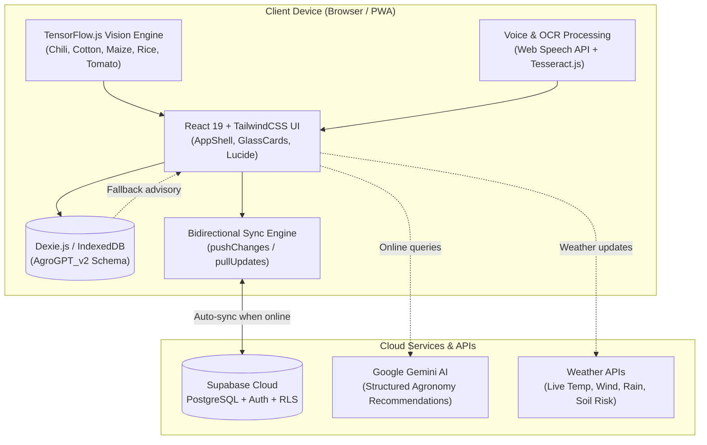

# 🌾 AgroGPT — Next-Gen Offline-First AI Agronomy System

<p align="center">
  <strong>Empowering farmers with offline-first intelligence, on-device disease diagnosis, dynamic precision crop scheduling, and AI-driven agronomy.</strong>
</p>

<p align="center">
  <a href="#features"></a>
  <a href="#tech-stack"></a>
  <a href="#tech-stack"></a>
  <a href="#tech-stack"></a>
  <a href="#tech-stack"></a>
  <a href="#tech-stack"></a>
  <a href="#localization"></a>
  <a href="#license"></a>
</p>

---

## 📖 Table of Contents
- [Overview](#-overview)
- [System Architecture](#-system-architecture)
- [Key Features](#-key-features)
  - [1. Precision Crop Calendar & Adaptive Scheduling](#1-precision-crop-calendar--adaptive-scheduling)
  - [2. Field Vision (On-Device Plant Pathology)](#2-field-vision-on-device-plant-pathology)
  - [3. Farm Health & Readiness Score Engine](#3-farm-health--readiness-score-engine)
  - [4. Ask AgroGPT (Multimodal AI Agronomist)](#4-ask-agrogpt-multimodal-ai-agronomist)
  - [5. Digital Khata (Financial Farm Ledger & OCR)](#5-digital-khata-financial-farm-ledger--ocr)
  - [6. Mandi & Market Intelligence](#6-mandi--market-intelligence)
  - [7. Bidirectional Offline-First Sync Engine](#7-bidirectional-offline-first-sync-engine)
  - [8. Vernacular Multi-Language Localization](#8-vernacular-multi-language-localization)
- [Tech Stack](#-tech-stack)
- [Repository Structure](#-repository-structure)
- [Getting Started](#-getting-started)
  - [Prerequisites](#prerequisites)
  - [Installation](#installation)
  - [Environment Variables](#environment-variables)
  - [Running Locally](#running-locally)
- [Supported Crops & Agronomic Models](#-supported-crops--agronomic-models)
- [Offline-First & Conflict Resolution Philosophy](#-offline-first--conflict-resolution-philosophy)
- [Contributing](#-contributing)
- [License](#-license)

---

## 🌟 Overview

**AgroGPT** is an intelligent agronomy operating system built specifically for the realities of Indian agriculture. Rural farms frequently suffer from unreliable cellular network connectivity, complex multi-lingual requirements, and volatile local weather conditions. 

AgroGPT solves these challenges with a **strict offline-first architecture**:
1. **Zero Network Latency for Core Workflows:** All agronomic calculations, stage progressions, financial ledger entries, and task completions execute instantaneously against a client-side **IndexedDB store** (`Dexie.js`).
2. **On-Device Computer Vision:** Farmers can scan infected leaves directly in the field with **TensorFlow.js** running in-browser models—diagnosing plant diseases without sending image bytes over the internet.
3. **Hybrid AI Advisory:** When connected, farmers receive context-aware agronomy prescriptions powered by Google Gemini (Flash); when offline, AgroGPT automatically falls back to an embedded, localized agronomic knowledge base.
4. **Seamless Cloud Synchronization:** Background workers sync local modifications to a **Supabase PostgreSQL** cloud backend whenever internet connectivity is restored, featuring version-first conflict resolution.

---

## 🏗️ System Architecture



---

## 🚀 Key Features

### 1. Precision Crop Calendar & Adaptive Scheduling
- **Deterministic Stage Generators:** Computes dynamic stage lifecycles (germination, vegetative, flowering, maturity) based on crop template parameters and sowing date.
- **Dynamic Task Engine:** Generates scheduled irrigation, fertilization, pesticide, and harvest tasks with support for recurring intervals.
- **Weather Sensitivity Rules:** Monitors environmental thresholds (temperatures, rainfall, wind speeds) and suggests automated schedule adjustments (e.g., postponing pesticide sprays during high wind or rain).

### 2. Field Vision (On-Device Plant Pathology)
- **Client-Side Model Inference:** Powered by TensorFlow.js with custom-quantized neural network models loaded into client memory.
- **Offline Disease Diagnostics:** Real-time classification for crops including **Chili**, **Cotton**, **Maize**, **Rice**, and **Tomato**.
- **Confidence Scoring & Treatment Plans:** Classifies confidence thresholds, displays localized organic and chemical remedy recommendations, and falls back to Gemini AI when higher nuance or second opinions are requested.

### 3. Farm Health & Readiness Score Engine
- **Deterministic Scoring (0–100):** Real-time algorithm assessing the holistic health and readiness of the farm.
- **Weighted Health Dimensions:**
  - **Task Completion Adherence (25%):** Penalizes overdue and neglected farm activities.
  - **Soil Health & NPK Balance (20%):** Compares nitrogen, phosphorus, and potassium levels against crop thresholds.
  - **Irrigation Efficiency (20%):** Evaluates watering routines and weather-related delays.
  - **Pest & Disease Stress (15%):** Dynamically deducts points if active leaf scans detect high-risk pathogens.
  - **Weather Stress Index (10%):** Flags heatwaves (>38°C), cold snaps (<10°C), or heavy precipitation.
  - **Crop Phenology Progress (10%):** Validates current days from sowing against expected stage timelines.

### 4. Ask AgroGPT (Multimodal AI Agronomist)
- **Context-Aware Prompts:** Fuses farmer profile details (soil type, crop variety, sowing date, soil NPK values, recent leaf scans) into agronomic prompts.
- **Voice-Enabled:** Integrated speech synthesis and speech-to-text input for low-literacy field usability.
- **Graceful Offline Degradation:** If network connectivity drops, requests are handled by an internal offline heuristic and keyword knowledge base.

### 5. Digital Khata (Financial Farm Ledger & OCR)
- **Income & Expense Tracking:** Category-wise cashflow monitoring (seeds, fertilizers, equipment, labor, mandi sales).
- **Voice & Receipt Ingestion:** Allows farmers to record transactions by speaking or uploading invoices/receipts using **Tesseract.js** OCR.
- **Offline Ledgering:** All transactions are logged instantly to IndexedDB and batched for cloud synchronization.

### 6. Mandi & Market Intelligence
- **Real-Time Mandi Rates:** Displays current market prices, Minimum Support Prices (MSP), and trend indicators across regional APMC markets.
- **Post-Harvest Guidance:** Advice on optimal selling windows, moisture content guidelines, and storage recommendations.

### 7. Bidirectional Offline-First Sync Engine

* **Push Phase:** Batches local mutations (`pending`, `pending_delete`) and sends upserts to Supabase in foreign-key-safe order (`profiles` → `crop_plans` → `crop_stages` → `farm_tasks`).

* **Pull Phase & Conflict Resolution:** Pulls incremental changes (`updated_at > lastSync`) using a **Version-First / Last-Write-Wins** strategy.

  **Conflict resolution rule:**

  The record with the highest `version` wins. If versions are equal, the record with the latest `updated_at` wins.

* **Soft-Delete Propagation:** Tombstone records ensure seamless cross-device synchronization without orphan foreign-key breaks.


### 8. Vernacular Multi-Language Localization
- Complete runtime translation across **English (`en`)**, **हिन्दी / Hindi (`hi`)**, and **తెలుగు / Telugu (`te`)** using `i18next`.
- **Database Consistency:** Internal keys and database states remain in canonical English to avoid synchronization drift; enum sanitizers dynamically translate values just-in-time at the presentation layer.

---

## 🛠️ Tech Stack

| Layer | Technologies |
| :--- | :--- |
| **Frontend Framework** | [React 19.2](https://react.dev/), [Vite 8.0](https://vitejs.dev/) |
| **Language** | [TypeScript 5.9](https://www.typescriptlang.org/) |
| **Styling & Icons** | [TailwindCSS 3.4](https://tailwindcss.com/), [Lucide React](https://lucide.dev/), Custom Glassmorphism UI |
| **Offline Database** | [Dexie.js 4.4](https://dexie.org/) (IndexedDB wrapper) |
| **Cloud Backend & Auth** | [Supabase](https://supabase.com/) (PostgreSQL with Row-Level Security, Google OAuth) |
| **Machine Learning & AI** | [TensorFlow.js 4.22](https://www.tensorflow.org/js), [Google Gemini 2.5 / 1.5 Flash](https://aistudio.google.com/) |
| **OCR & Vision** | [Tesseract.js 7.0](https://github.com/naptha/tesseract.js), [PDF.js](https://mozilla.github.io/pdf.js/) |
| **Mapping & Geospatial** | [Leaflet](https://leafletjs.com/), [React Leaflet 5.0](https://react-leaflet.js.org/) |
| **Charts & Analytics** | [Recharts 3.8](https://recharts.org/) |
| **Localization (i18n)** | [i18next 25.10](https://www.i18next.com/), [react-i18next 16.6](https://react.i18next.com/) |
| **PWA & Service Worker** | [vite-plugin-pwa 1.2](https://vite-pwa-org.netlify.app/), Workbox 7.4 |

---

## 📁 Repository Structure

```text
AgroGPT/
├── public/
│   └── models/               # Pretrained TensorFlow.js models (Chili, Cotton, Maize, Rice, Tomato)
├── src/
│   ├── ai/                   # Gemini API orchestration, prompt batching & mock fallbacks
│   ├── assets/               # Branding assets and static images
│   ├── components/           # Shared UI primitives (AppShell, AIAssistantPill, GlassCard)
│   ├── core/                 # Core utilities
│   │   ├── api/              # syncEngine.ts (Bidirectional IndexedDB <-> Supabase sync)
│   │   ├── auth/             # Supabase Auth provider and Google OAuth logic
│   │   ├── i18n/             # i18next runtime initialization
│   │   └── utils/            # Geolocation, cn helpers, math utilities
│   ├── engine/               # Headless agronomy engines (Risk, Severity, Recommendations)
│   ├── features/             # Domain-specific feature modules
│   │   ├── crop-calendar/    # Precision schedule generator, crop templates, timelines
│   │   ├── dashboard/        # Readiness score calculator, KPI cache, quick actions
│   │   ├── digital-khata/    # Financial ledger, voice transaction entry, OCR invoice scanner
│   │   ├── field-vision/     # Camera leaf capture, TF.js inference, confidence engine
│   │   ├── gis/              # Weather APIs and geospatial mapping
│   │   ├── market/           # Mandi prices and post-harvest advisory
│   │   ├── onboarding/       # Farm setup wizard (soil, acreage, crops)
│   │   └── settings/         # Farm profile, theme, language switcher
│   ├── hooks/                # Custom React hooks (useConnectivity, useEnumTranslation)
│   ├── knowledge-Base/       # Offline disease descriptions and treatment manuals
│   ├── lib/                  # Database definitions (db.ts schema v6, repositories)
│   ├── locales/              # Translation dictionaries (en, hi, te)
│   ├── pages/                # Top-level view routes (Auth, Not Found)
│   ├── App.tsx               # Root application router and shell
│   └── main.tsx              # App bootstrap and service worker registration
├── docs/                     # Detailed architectural, sync, and agronomic specifications
├── package.json              # Dependencies and scripts
├── tailwind.config.js        # Custom theme, colors, and blur settings
└── vite.config.ts            # Vite bundler and PWA manifest configuration
```

---

## ⚡ Getting Started

### Prerequisites
- [Node.js](https://nodejs.org/) `>= 18.0.0`
- [npm](https://www.npmjs.com/) `>= 9.0.0`
- A [Supabase](https://supabase.com/) project (free tier works)
- A [Google Gemini API Key](https://aistudio.google.com/app/apikey) (optional, for cloud AI features)

### Installation

1. **Clone the repository:**
   ```bash
   git clone https://github.com/syedwasi86/AgroGpt.git
   cd AgroGpt
   ```

2. **Install project dependencies:**
   ```bash
   npm install
   ```

### Environment Variables

Copy the `.env.example` file to create your local `.env`:
```bash
cp .env.example .env
```

Fill in your configuration:
```env
# Supabase Configuration
VITE_SUPABASE_URL=https://your-project-id.supabase.co
VITE_SUPABASE_ANON_KEY=your-anon-key-here

# Google Gemini API Key
VITE_GEMINI_API_KEY=your-gemini-api-key-here
```

### Running Locally

Start the Vite development server:
```bash
npm run dev
```
Open your browser at `http://localhost:5173` to view the application.

To build the optimized production bundle:
```bash
npm run build
```

To preview the production build locally:
```bash
npm run preview
```

---

## 🌾 Supported Crops & Agronomic Models

AgroGPT ships with deep agronomic parameters and computer vision models tailored for major staple and cash crops:

| Crop | Lifecycle Duration | Critical Phenology Stages | On-Device Model |
| :--- | :--- | :--- | :---: |
| **Cotton** | ~150 Days | Germination, Squaring, Flowering, Maturity | ✅ Available |
| **Rice (Paddy)** | ~120 Days | Nursery, Transplanting, Panicle, Ripening | ✅ Available |
| **Maize (Corn)** | ~110 Days | Establishment, Vegetative, Tasseling, Grain Fill | ✅ Available |
| **Tomato** | ~130 Days | Establishment, Vegetative, Flowering, Ripening | ✅ Available |
| **Chilli** | ~140 Days | Establishment, Vegetative, Flowering, Ripening | ✅ Available |

---

## 🔄 Offline-First & Conflict Resolution Philosophy

AgroGPT operates on a simple premise: **the user's physical field work must never be blocked by lack of connectivity.**

1. **Local Writes First:** Every task checkmark, expense entry, and scan result writes directly to IndexedDB with `sync_status: 'pending'`.
2. **Deterministic Versioning:** Each record carries an integer `version` field incremented on mutation.
3. **Conflict Arbitration:**
   - Higher record `version` wins during cloud reconciliations.
   - If versions match, the latest `updated_at` timestamp takes precedence.
4. **Soft Deletions:** Deleting an item locally flags it with `pending_delete` and records `deleted_at`. The sync engine ensures the tombstone is safely updated in the cloud before pruning local storage.

---

## 🤝 Contributing

Contributions are welcomed! To get started:
1. Fork the repository.
2. Create a dedicated feature branch:
   ```bash
   git checkout -b feature/amazing-feature
   ```
3. Commit your changes:
   ```bash
   git commit -m "feat: implement amazing feature"
   ```
4. Push to the branch:
   ```bash
   git push origin feature/amazing-feature
   ```
5. Open a Pull Request for review.

---

## 📄 License

This project is licensed under the [MIT License](LICENSE).
